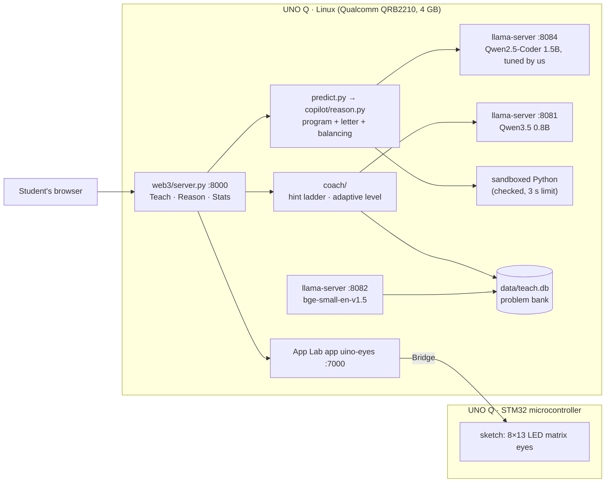

# Uino: an offline maths tutor on the Arduino UNO Q

**Datathon FME 2026 · Qualcomm challenge "Math on the Edge" · team TIC's Friends**

Uino is an owl that helps students with Kangaroo (Cangur) competition problems. Everything runs on an Arduino UNO Q 4 GB inside a 3D-printed owl, with no internet. It has two modes:

- **Teach** never gives the answer away. A student answers problems at their level, in Catalan or English. When they get one wrong, they climb a ladder of hints: a similar, easier problem; a way to start; Uino's own idea; and the solution only at the end. The level adapts to the student.
- **Reason** answers a multiple-choice problem in under 60 seconds. A small language model writes a short Python program, the board runs it, and the result is matched to an option.

The owl's eyes are the board's LED matrix: they blink, think, wink for a hint, and show when an answer is right or wrong.

## Architecture



- **Linux side.** Three `llama-server` processes: the code model that writes programs, the 0.8B model for the coach's live answers, and an embedding model for similar problems. `web3/server.py` (Python standard library only) serves the page and calls them on `127.0.0.1`.
- **Microcontroller side.** The sketch in `coach/applab/sketch/` stores the eye animations (generated by `owl_eyes/eyes.py`) and plays the state the Linux side asks for over the Arduino Bridge.
- **How we use M3Kang.** Teach's bank is the 514 M3Kang problems that need no figure and have five readable options, with their nearest neighbours from the embeddings, so "similar and easier" is a lookup. Reason's code model was trained on short programs for 673 M3Kang problems and 500 problems we invented (below). M3Kang is for research use only: no problem text, image or derived model is in this repository. Dataset card: <https://huggingface.co/datasets/qualcomm/M3Kang> (Torres-Camps et al., 2026, [arXiv:2601.16218](https://arxiv.org/abs/2601.16218)).

### Reason: how one problem is answered (`copilot/reason.py`)

1. **A program.** The code model reads the problem and writes a short Python program (about 35 tokens). We check it (imports limited to `math`, `itertools`, `fractions`, `functools`, `collections`; no files, no `exec`) and run it in a separate Python with a 3 s limit. If the printed number equals exactly one option, that option is the answer.
2. **A letter.** Otherwise the answer is the letter the model finds most likely. The question reuses the problem already read, so it costs about 4 s.
3. **Balancing.** The practice answer key uses every letter equally, and the model doesn't. After all problems, the letter answers from step 2 are re-assigned so each letter is used about equally, keeping the most likely assignment. Program answers never change. Turn it off with `--no-balance`.

The program is cut exactly at 44 s, so every answer arrives before 50 s. If the code model's file is missing, the earlier pipeline answers with the 0.8B model.

### The program-writing model

We first tuned Qwen2.5-Math-1.5B, then Qwen2.5-Coder-1.5B with the same recipe plus 500 problems we invented ourselves (2,346 examples); the code model writes more programs that are right, and is the one shipped (`qwen25-coder-15b-code2-e3-Q4_K_M.gguf`). The recipe: Qwen2.5-Math-1.5B writes good programs but long ones, and the board writes 3 tokens a second. We fine-tuned it to write short ones: a large model wrote a program for each of 734 M3Kang problems, we ran them all and kept the 673 whose result equals the correct option, and trained for 3 epochs on those (English and Catalan text, 1,346 examples; about 3 minutes on one RTX 4090). Details: [machine/NOTES_MATH.md](machine/NOTES_MATH.md).

## How to replicate it

Start from a board set up with steps 0–12 of the [setup guide](docs/SETUP_GUIDE.md): llama.cpp built, the two model services running, `data/index.db` built.

```bash
# On the board
git clone https://github.com/u215231/datathon-UPC-maths-qualcomm-arduino-unoq.git ~/uino
cd ~/uino

# Reason: the official entry point
python3 predict.py --input data/val.jsonl --output results/predictions.csv
# Each line: [n/N] id -> letter in seconds (status, letter|code); then "Balanced the letters: k of N changed"

# Everything, starting by itself at every boot (page on port 8000, LED eyes): about 3 minutes, no sudo
bash owl/install.sh
```

Then open `http://<board-ip>:8000`, or over USB: `adb forward tcp:8000 tcp:8000` and <http://127.0.0.1:8000>. [owl/README.md](owl/README.md) has every step, what you should see, and how to read a photo of a problem from a laptop (Tesseract, with RapidOCR as the fallback).

The model file (`qwen25-coder-15b-code2-e3-Q4_K_M.gguf`, 986 MB) goes in `~/models`; [machine/NOTES_MATH.md](machine/NOTES_MATH.md) says how to make it. Without it, Reason uses the 0.8B model.

## Results

All Reason numbers are on the organisers' **practice set: 50 new problems × English and Catalan = 100 rows**, measured on the board unless noted. They are not M3Kang problems and were never used for training. Chance is 20%. With 100 rows, differences under about 6 points are noise.

| Pipeline | Right, of 100 | Time per problem on the board |
| --- | --- | --- |
| Organisers' baseline: Qwen3.5 0.8B, one letter | 22 | about 10 s |
| Bigger model: Qwen3.5 2B, one letter | 21 | about 17 s |
| Bigger model: Qwen3.5 4B, one letter | 22 | 91 of 100 over 60 s |
| Weight-space-programming 0.8B, with reasoning | 22 (on 100 M3Kang problems) | about 44 s |
| 0.8B thinks freely, cut at 50 s | 25 | 50 s |
| 0.8B: letter + Python + balancing | 27 | mean 33 s, max 49 s |
| Tuned maths model (Qwen2.5-Math 1.5B) + letter + balancing | 33 (32 on a first run) | mean 35 s, max 46 s |
| **Uino, shipped: tuned code model (Qwen2.5-Coder 1.5B) + letter + balancing** | **47** | **mean 33 s, max 52 s** |

- The shipped code model's program matched an option on 40 problems and was right on 31. Its letter answers were right 16 times in 60. English 50%, Catalan 44%. On a laptop, the same 4-bit file scores 44.
- The maths model's program matched an option on 30 problems and was right on 19. The other 70 answers are letters, and those are at chance (14 right).
- The same model on a laptop scores 38 (4-bit) to 43 (8-bit): no time pressure there.
- No answer took more than 50 s in the final run, and none timed out.

Teach (measured on our board): the hint ladder answers in milliseconds, because every rung is a lookup or was written ahead of time; a live question to the coach takes 20–30 s; `coach/check.py` plays a student through 27 checks, including that a wrong answer never reveals the solution. More in [coach/README.md](coach/README.md).

## Error analysis (final board run, 100 rows)

| Group | Right | Rows |
| --- | --- | --- |
| English | 34% | 50 |
| Catalan | 32% | 50 |
| Answered by the program | 63% | 30 |
| Answered by the letter | 20% | 70 |
| Text only (first run) | 34% | 80 |
| Needs the figure (first run) | 25% | 20 |

- When a program runs but matches no option, it is nearly always simply wrong (it printed 240 when the options are 1 to 10), not a formatting slip.
- About 30 programs do not run at all: the model writes `=` for `==`, or repeats a term until its tokens run out. These are problems it cannot model.
- Ten of the 100 rows have options that are names or clock times, which a printed number cannot match.

## What didn't work

- **Bigger general models.** Within 60 s on this board they are no better than the 0.8B, or too slow.
- **Fine-tuning on answers.** A full fine-tune of the 0.8B on problem → letter learned the 1,747 bank problems by heart (24/24 on the board) and stayed at chance on new problems.
- **Fine-tuning the 0.8B on programs.** It overfits after one epoch; 36 against 33 in simulation, inside the noise.
- **More training data.** 500 invented problems with checked programs on top of the 673: 21 right of 31 matched, against 24 of 31.
- **Reading each problem once with the 0.8B** (its cache cannot be rewound, so the old pipeline read every problem twice): the faster variants scored 29 to 33 against 33.
- **A prior for the middle value.** In M3Kang the correct numeric option is the middle one 29% of the time and the smallest 9%; in the organisers' problems it is evenly spread, so it gave nothing.
- **A second program attempt, a later deadline, repairing `=`, the nearest option:** no gain.
- **Free-form hints from the 0.8B.** Often wrong, or they gave the answer away. Teach uses lookups and checks every model-written sentence in code.

**Next:** a model that can also answer with a name or a time; programs for problems with figures, from a description of the figure; reading the hints with a teacher before students use them.

## Repository map

| Path | What |
| --- | --- |
| `predict.py`, `eval.py` | the official entry point; evaluation on a labelled file |
| `config.env` | pinned models and llama.cpp commit, every setting |
| `copilot/` | Reason: `reason.py` (the code model route, the 0.8B route, the sandbox, balancing), `pipeline.py` (`solve`), `teach.py` (hint wording and the answer-leak check), `rag.py`, `llm.py` |
| `coach/` | Teach: the hint ladder and adaptive trainer (`core.py`), hints from the board's own solutions (`grounded.py`), `check.py` (27 checks), the LED app (`applab/`) |
| `web3/` | the web page: Teach, Reason, Stats; `server.py` (Python standard library), `read_picture.py` (picture reading), `public/data/stats.json` (the numbers on Stats) |
| `owl/` | plug and play: `install.sh` (start at every boot), `start.sh`, `usb.sh` (keep the ports forwarded over USB) |
| `owl_eyes/` | the eye animations: `eyes.py` generates the sketch; `previews/` |
| `machine/` | laptop work: `distil/` (how the code model was trained, with the 500 invented problems), `NOTES_MATH.md`, `score_run.py`, earlier model screening (`lab.py`) |
| `m3kang/` | preparing M3Kang on a laptop: parquet to JSON lines, OCR of the options |
| `reason/` | log-probability experiments behind the table in `coach/README.md` |
| `board/`, `docs/SETUP_GUIDE.md` | the organisers' board setup scripts and guide (steps 0-15) |
| `explorer/`, `streamlit-app/` | the organisers' problem explorer and an early dashboard |
| `docs/PROJECT_HUB.md` | the Arduino Project Hub write-up |

## The team

TIC's Friends: Marc Bosch Manzano, Blanca García Rodríguez, Darcy Thomas Robertson, Shuangjie Xia. Built on the organisers' starter repository (mpous/datathon-UPC-maths-qualcomm-arduino-unoq).
